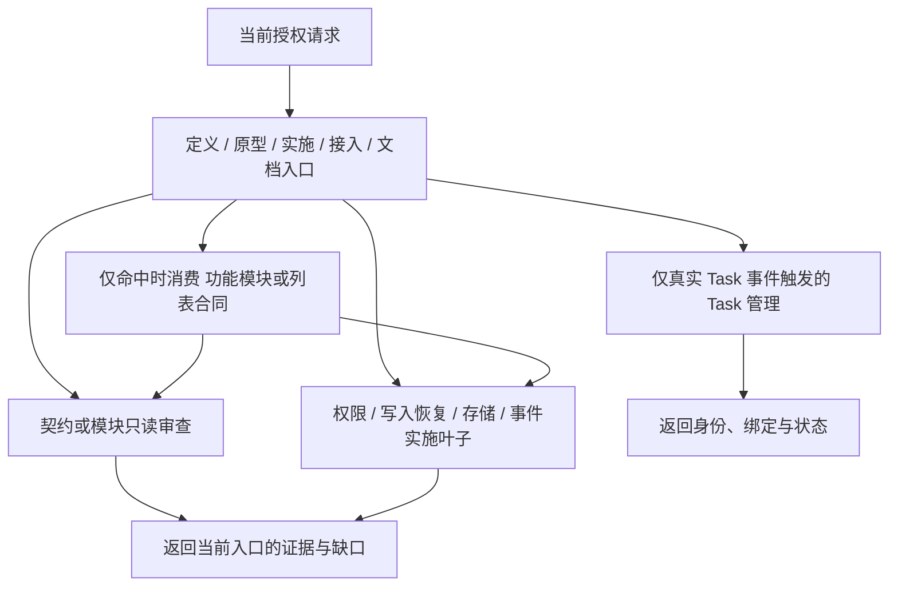

# Skill 职责与组合

本专题解释当前源 Harness 的能力拆分及调用关系。执行规则以 [工程规则](../ENGINEERING_RULES.md#72-skill-职责复用与渐进披露) 为准；本地图不启动产品流程，不保存另一份业务规格。

## 发现、执行、参考三层

1. 发现层使用目录名、frontmatter 与 `agents/openai.yaml`，只说明独立触发、职责和结果，避免把“包含某关键词”当成自动调用条件。
2. 执行层完整读取当前命中的 `SKILL.md`，确认范围和写入边界。阶段入口保留编排，叶子只做一项可复用工作，完成后返回当前入口。
3. 参考层按阶段、宿主和实际能力读取规范章节、参考文件或资产。需求任务不为完整性读全部实施/设计资料，SSE 不连带读取 RxJS，列表不启用列偏好就不适配迁移资产。

调用方传入范围、阶段、事实来源与仍有效的验证证据。每个事实只有一个拥有者，不因调用新的 Skill 再创建 PRD、索取全套 API、复读无关策略或运行完整验收。

## 全部能力地图

以下 31 个 `web-*` Skill 为源能力；实际下游只分发当前宿主适用部分。表中名称均对应 `.agents/skills/<名称>/SKILL.md`。

| 职责组     | 独立入口                                                                                       | 结果与保留边界                                                       |
| ---------- | ---------------------------------------------------------------------------------------------- | -------------------------------------------------------------------- |
| 创建与环境 | `web-instantiate-project`、`web-check-development-environment`、`web-prepare-brand-identity`   | 新下游、环境诊断、品牌资产分别交付；检查不自动安装，品牌不重新初始化 |
| 产品与设计 | `web-define-product`、`web-design-prototype`                                                   | 唯一 PRD 与单一桌面原型摘要分别拥有记录；原型不代替实施              |
| 实施与重构 | `web-implement-change`、`web-refactor-code`                                                    | 授权行为变化与行为保持重构分别验证；按事件调用叶子                   |
| 模块审查   | [`web-review-module-boundaries`](../../.agents/skills/web-review-module-boundaries/SKILL.md)   | 只读职责、依赖和状态拥有者地图；不自动重构                           |
| 接口契约   | [`web-review-api-contract`](../../.agents/skills/web-review-api-contract/SKILL.md)             | 只读当前操作的来源/实现关联与差异；不联网、不写模块文档              |
| 服务与文档 | `web-connect-http-service`、`web-document-api`                                                 | 已授权真实接入与合同/实现文档分别负责；设计与 Mock 不冒充已联调      |
| 访问控制   | [`web-implement-access-control`](../../.agents/skills/web-implement-access-control/SKILL.md)   | 菜单、路由和动作的一致判断与撤权；身份/权限获取仍归认证              |
| 写入恢复   | [`web-implement-write-recovery`](../../.agents/skills/web-implement-write-recovery/SKILL.md)   | 当前操作的防重复、未知查询、冲突和成功后刷新；允许状态仍归领域       |
| 本地存储   | [`web-implement-browser-storage`](../../.agents/skills/web-implement-browser-storage/SKILL.md) | 真实存储访问、校验、迁移与失败语义；凭据例外和列表 key 仍归领域      |
| 持续事件   | [`web-implement-event-stream`](../../.agents/skills/web-implement-event-stream/SKILL.md)       | 实际协议的连接、恢复与投影；不默认采用 RxJS 或持续后台               |
| UI 专项    | `web-implement-list-view`、`web-extract-i18n-strings`                                          | Web 列表行为与既有语言资源迁移各自内聚，不按控件/语言碎片化          |
| 功能组合   | `web-compose-capabilities`                                                                     | 按操作选择独立知识与模板，显式组合，返回当前流程                     |
| 宿主审查   | `web-review-extension-compatibility`                                                           | 只读受影响消费者的双目标证据；修复与真实候选仍归调用方               |
| 用户 Task  | [`web-manage-user-tasks`](../../.agents/skills/web-manage-user-tasks/SKILL.md)                 | 左侧 Task 编号、身份绑定和真实进度；不代做业务或开启长期开关         |
| 计划与 Git | `web-plan-change`、`web-configure-git-commits`                                                 | 独立事件触发的持久计划与实际提交配置，不成为日常必经步骤             |
| 内部工作树 | `web-audit-worktrees`、`web-run-parallel-worktrees`                                            | 既有证据审计与已获准内部并行分别负责；不代替左侧 Task                |
| 候选与验收 | `web-prepare-release`、`web-verify-delivery`、`web-test-final-artifact-e2e`                    | 候选准备、准入/结论、已批准场景证据分别拥有；日常开发不自动调用      |
| 升级       | `web-preview-harness-upgrade`、`web-upgrade-harness`                                           | 只读冻结比较与批准后的应用分别负责，先补齐叶子再更新父入口           |
| 历史与记忆 | `web-summarize-development-history`、`web-curate-harness-memory`                               | 只读追溯与源历史整理分别负责，不因回顾自动改写记录                   |

## 调用方向与事实归属

需求或原型阶段读取领域合同只补充当前阶段的事实，不调用实施叶子修改代码。直接命中叶子时仍执行必要的项目/范围门禁，但不反向重走整套编排；真正范围变化返回当前入口处理。

认证继续负责身份、组织、权限获取、会话与凭据限定例外；访问控制消费当前上下文。购买和后台合同继续负责订单允许状态、历史金额快照、钱包与审计；恢复叶子负责通用的未知/冲突处理。数据访问、工程与策略文档继续拥有规范正文。

## 继续保持内聚的部分

- 登录、注册、找回与退出共享会话生命周期，保留同一认证 Skill，用参考文件区分 SOP 与实施合同。
- REST、GraphQL 与公共工具说明由同一文档 Skill 按模块边界整理；REST 导出、GraphQL 文档和工具说明分别交付，不混排，也不另建相互竞争的生成入口。
- 初始化与环境、Worktree 审计与执行、升级预演与应用、候选与验收已有独立结果，不再按每个命令拆转发壳。
- 渐进式提问和默认建议是通用工程约定，保留在工程规则，不新增每次必读的交互 Skill。

## 分发与升级

源为 **33** 个；Web 删除 2 个源专用与 1 个 Extension 专属，保留 **30** 个维护 Skill；Extension 删除 2 个源专用与 4 个 Web 专属，保留 **27** 个。项目级 `design-taste-frontend` 单独计数。

新增叶子同时进入源发现合同、终端目录/关键正文门禁、三份独立升级所有权及精确文件传播清单。现有下游升级须先补齐叶子与元数据再委托或更新父入口，不能因目录数量正确就忽略内容陈旧。
